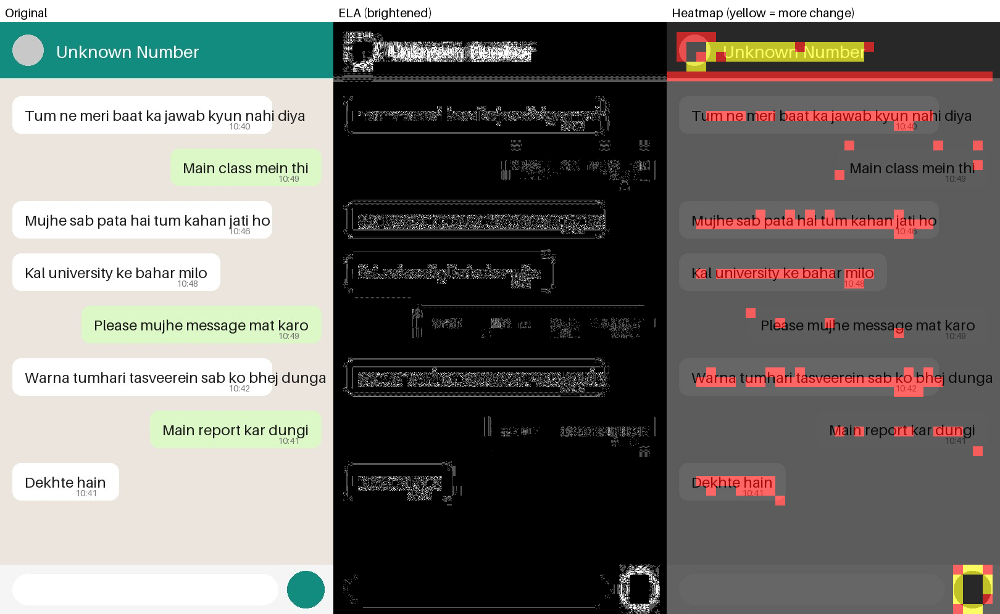
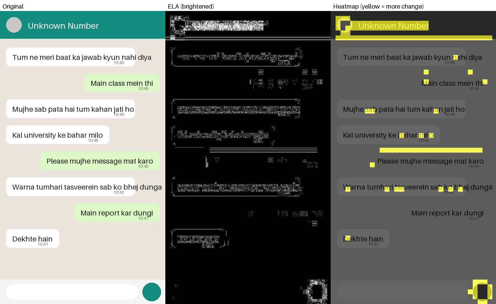
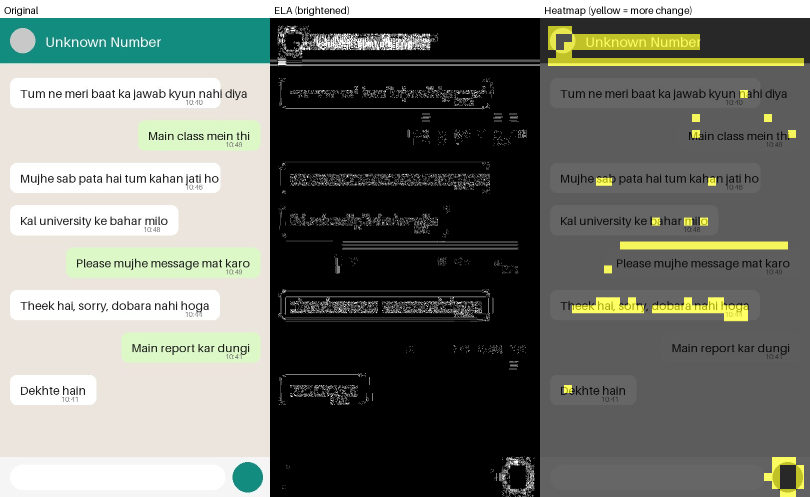
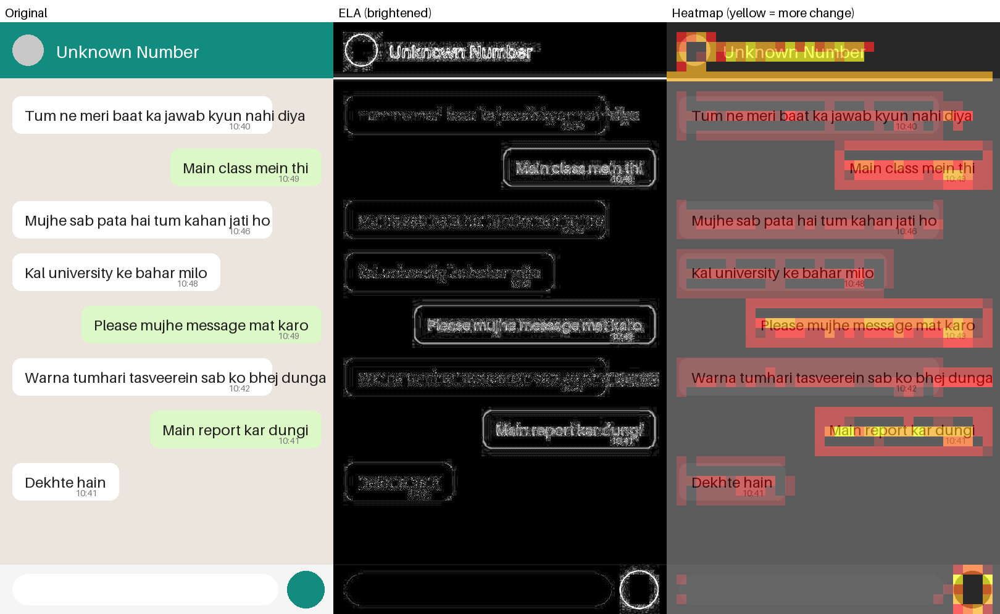

# ELA prototype results

Generated 2026-10-20T21:28:22. Each image is re-saved as JPEG at quality 90; the error level is how much each pixel changed (0-255).

| Image | Format | Mean error | 99th pct | Max | Panel |
|---|---|---|---|---|---|
| jpeg_original.jpg | JPEG | 0.143 | 3 | 11 |  |
| jpeg_resaved.jpg | JPEG | 0.086 | 1 | 8 |  |
| jpeg_edited.jpg | JPEG | 0.096 | 2 | 8 |  |
| original.png | PNG | 0.739 | 9 | 32 |  |

## Check against the known edit

Average error inside the edited chat message compared with the other messages (synthetic sample, so the edit location is known).

| Image | Edited message | Other messages (avg) | Other messages (max) | Ratio |
|---|---|---|---|---|
| jpeg_resaved.jpg | 0.134 | 0.066 | 0.140 | 2.05x |
| jpeg_edited.jpg | 0.267 | 0.066 | 0.140 | 4.08x |

## How to read this

- In the edited JPEG, the replaced message was compressed once while the rest was compressed twice, so it changes more on re-save and stands out in the heatmap.
- In the unedited JPEG, that message behaves like the other messages.
- Header, icons and coloured areas glow in every image: sharp edges and colour always produce more error.
- The PNG screenshot has no compression history, so ELA there mostly shows edges.
- ELA points a person at areas to check; it is not proof that an image was edited.
